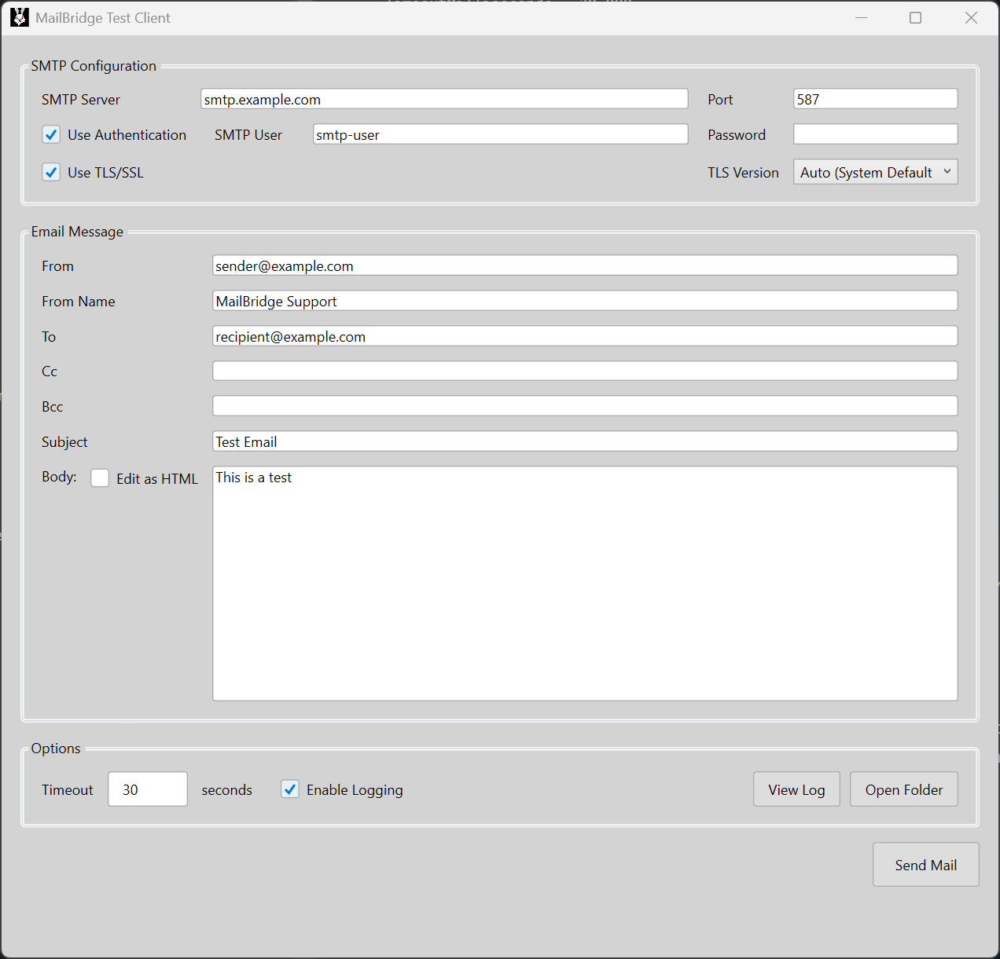
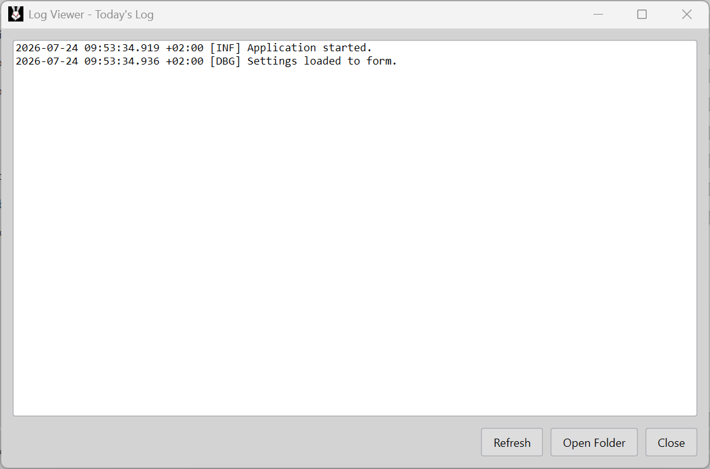

# MailBridge.Wpf

A lightweight WPF desktop client for testing SMTP email delivery, built on top of [MailBridge.Core](../MailBridge.Core) and MailKit.




## Features

- **SMTP configuration** — server, port, TLS/SSL with selectable TLS version, optional authentication (username/password).
- **Email composition** — From (with display name), To, CC, BCC, Subject, and a plain-text or rich HTML body.
- **HTML editing** — Toggle between a plain-text editor and a WebView2-based HTML editor. Pasting formatted content (e.g. from Microsoft Word) preserves tables and styles.
- **Persisted settings** — SMTP server, port, credentials (excluding password), TLS options, and email addresses are saved locally and restored on next launch.
- **Logging** — Built-in logging via Nlog, toggleable from the UI, with a log viewer window and quick access to the log folder.
- **Cancellable sending** — Long-running send operations can be cancelled, with a configurable connection timeout.

## Requirements

- Windows 10/11
- .NET 8.0 Desktop Runtime
- [WebView2 Runtime](https://developer.microsoft.com/microsoft-edge/webview2/) (usually pre-installed on modern Windows)

## Getting Started

1. Clone the repository and open the solution in Visual Studio 2022 or later.
2. Build and run the `MailBridge.Wpf` project.
3. Fill in your SMTP server details, sender/recipient addresses, and message content.
4. Click **Send Mail** to test delivery.

## Configuration

Settings are stored as JSON in: 
```
%LocalAppData%\MailBridge\settings.json
```
This file is created automatically on first save and includes SMTP connection details, saved email addresses, and logging preference. Passwords are never persisted and must be re-entered each session.

## HTML Body Editing

Enable **Edit as HTML** to switch the message body to a WebView2-based rich text editor. Pasting HTML content (e.g. copied from Word or a browser) automatically extracts and preserves formatting, including tables. Switching back to plain text retains the last entered plain-text body independently.

## Logging

Logs are written via NLog and can be enabled or disabled from the **Options** section. Use **View Log** to open the built-in log viewer, or **Open Folder** to browse the log directory directly. Logging targets and the log file location are configured via `NLog.config`, included with the application.




## License

Shield: [![CC BY-NC-SA 4.0][cc-by-nc-sa-shield]][cc-by-nc-sa]

This work is licensed under a
[Creative Commons Attribution-NonCommercial-ShareAlike 4.0 International License][cc-by-nc-sa], see [license](/license).

[![CC BY-NC-SA 4.0][cc-by-nc-sa-image]][cc-by-nc-sa]

[cc-by-nc-sa]: http://creativecommons.org/licenses/by-nc-sa/4.0/
[cc-by-nc-sa-image]: https://licensebuttons.net/l/by-nc-sa/4.0/88x31.png
[cc-by-nc-sa-shield]: https://img.shields.io/badge/License-CC%20BY--NC--SA%204.0-lightgrey.svg